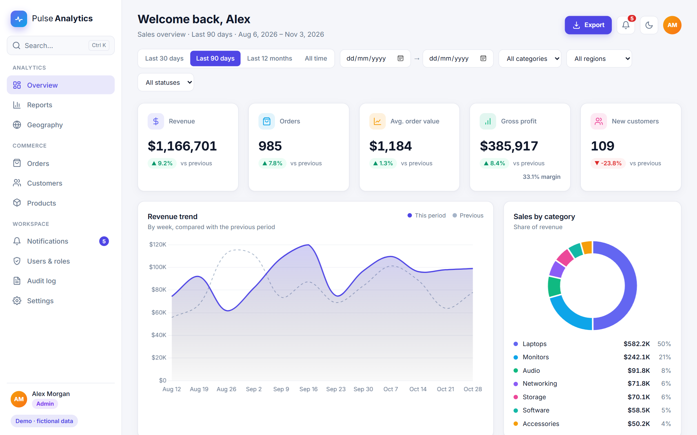
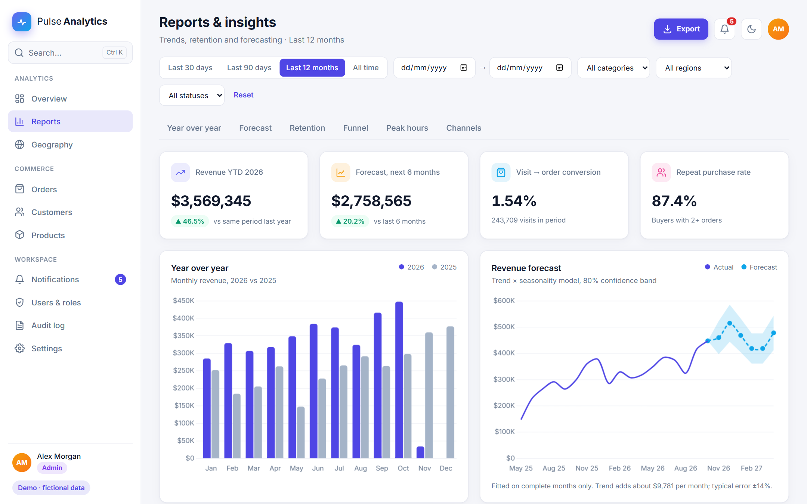
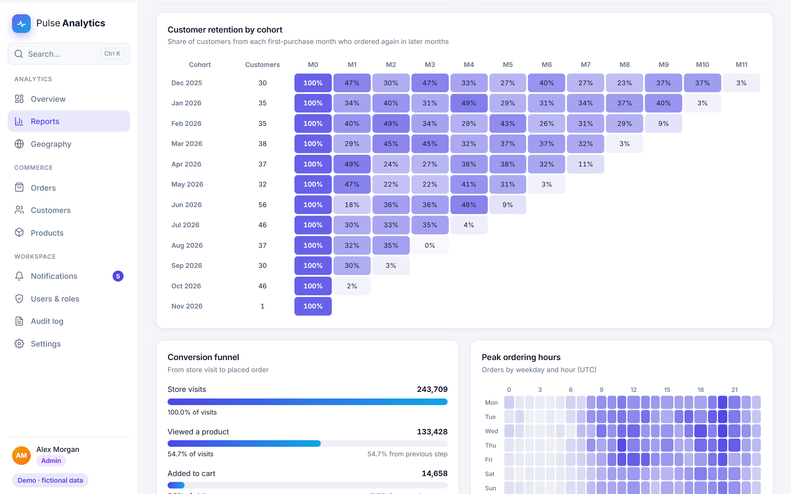
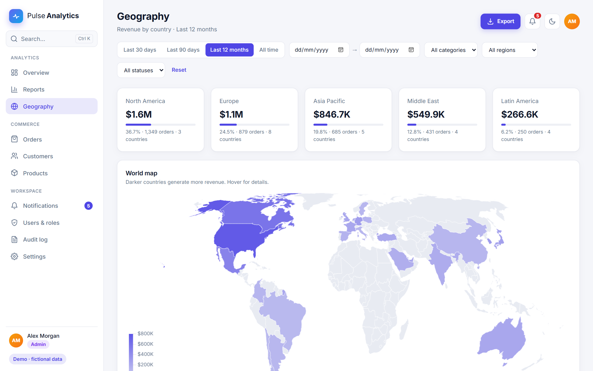
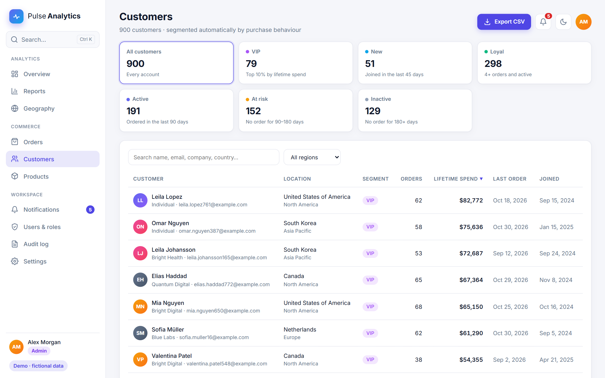
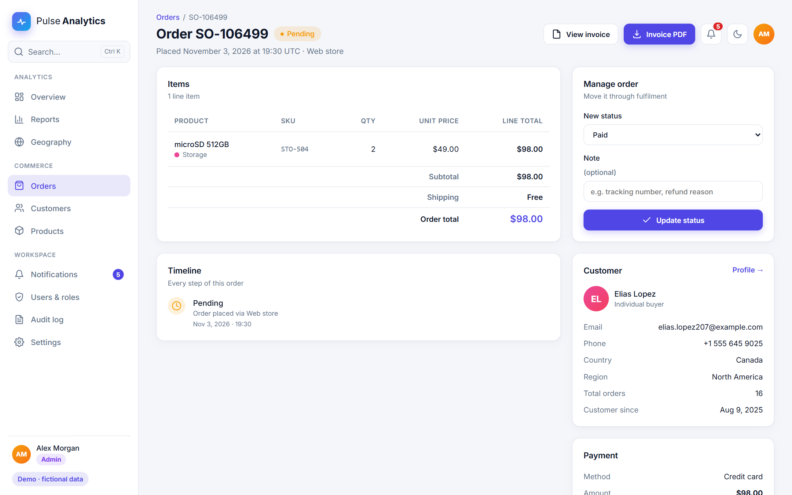
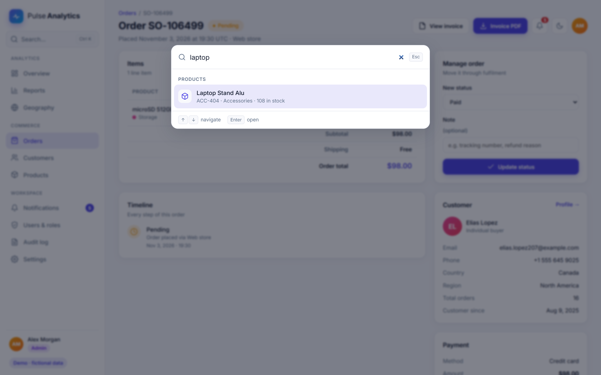
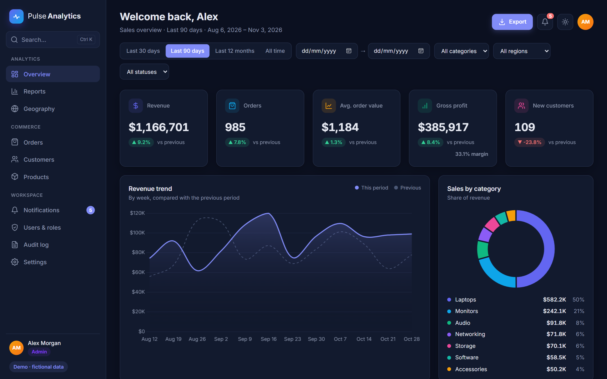
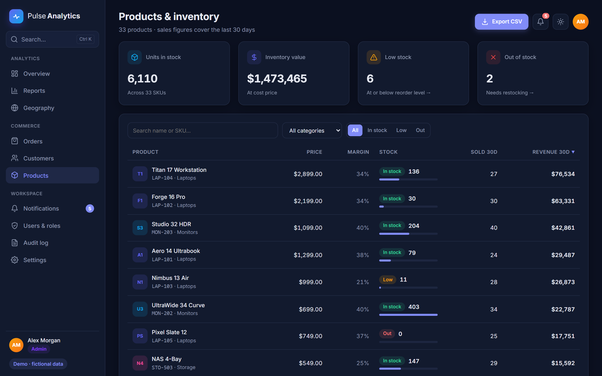
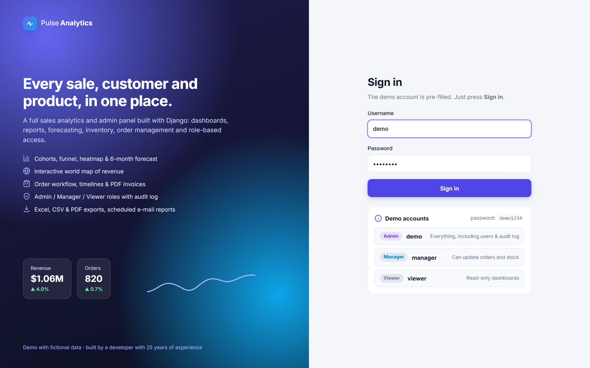

# Pulse Analytics: Sales Analytics & Admin Panel (Django)

A complete sales analytics and back-office panel built with **Django** and server-rendered templates.
All data is **fictional** and generated by a management command.



| | |
|---|---|
|  |  |
|  |  |
|  |  |
|  |  |
|  | |

## Demo login

The login form is pre-filled with the Admin account, so you only need to press **Sign in**.
The other accounts are one click away on the login page.

| Username  | Password   | Role    | Can do |
|-----------|------------|---------|--------|
| `demo`    | `demo1234` | Admin   | Everything, including users & roles and the audit log |
| `manager` | `demo1234` | Manager | Change order status, update stock |
| `viewer`  | `demo1234` | Viewer  | Read-only dashboards and exports |

Demo accounts can't change their password or role, so every visitor gets the same experience.
Set `DEMO_PASSWORD` to use a different password.

## Features

**Analytics**
- Overview: KPI cards with change vs previous period, revenue trend vs previous period, category, region, order volume and status charts, top products & customers, inventory alerts
- Reports: year-over-year comparison, 6-month revenue forecast (trend × seasonality with confidence band), monthly cohort retention table, conversion funnel, weekday × hour heatmap, sales channels, payment methods
- Geography: interactive world choropleth map, region summary, country table with change vs previous period
- Shared filters on every analytics page: date presets, custom range, category, region, status

**Commerce**
- Orders: search, sort, pagination; order detail with line items, timeline of every status change, customer & payment info
- Order workflow: managers move orders through Pending → Paid → Shipped → Delivered / Refunded, with notes
- PDF invoices for every order
- Customers: automatic segments (VIP, New, Loyal, Active, At risk, Inactive), lifetime spend, customer profile with spend chart, favourite categories and order history
- Products & inventory: stock levels, low / out-of-stock filters, inventory value, 30-day sales, product page with weekly sales chart and stock run-out estimate, stock updates

**Workspace**
- Sign-in with Admin / Manager / Viewer roles enforced on every action
- Users & roles management, enable / disable accounts
- Audit log of sign-ins, status changes, stock updates, exports and settings changes (with IP)
- In-app notifications (new orders, low stock, refunds, reports) with a bell menu and a full page
- Global search / command palette with **Ctrl + K** across orders, customers, products and pages
- Settings: profile, display currency (USD / EUR / GBP), time zone, accent colour, password
- Exports: Excel, CSV and PDF sales report; **scheduled e-mail reports** (daily / weekly / monthly)
- Dark mode, responsive layout for phones

## Tech stack

Python 3.12 · Django 5.2 · SQLite · Chart.js 4 + chartjs-chart-geo · ReportLab (PDF) · openpyxl (Excel) · WhiteNoise · Gunicorn · Docker

## Run locally

```bash
python -m venv .venv
.venv\Scripts\activate          # Windows  (macOS/Linux: source .venv/bin/activate)
pip install -r requirements.txt
python manage.py migrate
python manage.py seed_demo      # 6,500 orders over 26 months + demo users
python manage.py runserver
```

Open http://127.0.0.1:8000 and sign in with the pre-filled demo account.

`seed_demo` options: `--orders`, `--customers`, `--months`, `--seed`, `--if-empty`.

Run the tests with `python manage.py test dashboard`.

## Scheduled reports

```bash
python manage.py send_scheduled_reports         # sends reports that are due
python manage.py send_scheduled_reports --all   # sends every active report now
```

Run it hourly from cron or any scheduler. By default e-mails are printed to the server log;
set `EMAIL_BACKEND` and the usual Django SMTP settings to deliver them.

## Deploy to Render (free)

1. Push this folder to a GitHub repository.
2. On Render, choose **New → Blueprint** and select the repository. Render reads `render.yaml`
   and builds the `Dockerfile`.
3. On every start the container runs migrations, seeds demo data and the demo accounts if the
   database is empty, then starts Gunicorn.

The free plan sleeps after a period of inactivity, so the first visit can take a while to load.
It also has no persistent disk, so the demo resets to fresh data after each restart.

## Project layout

```
config/                     settings, URLs
dashboard/
  models.py                 catalogue, customers, orders, timeline, traffic, profiles, audit, notifications, reports
  analytics.py              KPIs, series, YoY, forecast, cohorts, funnel, heatmap
  filters.py                query-string filters shared by analytics pages
  roles.py                  Admin / Manager / Viewer permissions
  pdf.py                    invoices and sales report (ReportLab)
  exports.py                CSV and Excel responses
  scheduled.py              builds and e-mails scheduled reports
  views/                    overview, reports, orders, customers, products, search, notifications, system
  management/commands/      seed_demo, send_scheduled_reports
  templates/dashboard/      server-rendered pages
static/                     CSS (light/dark, accent themes) and page scripts
```
